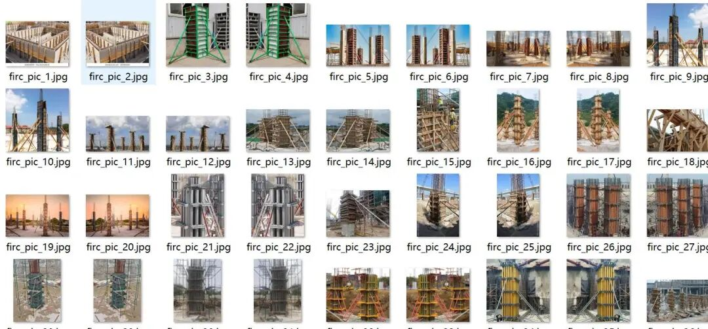
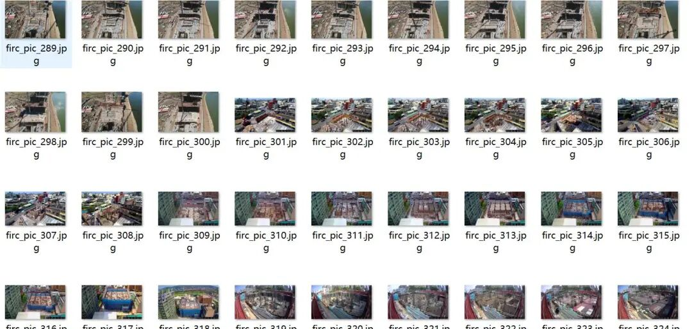
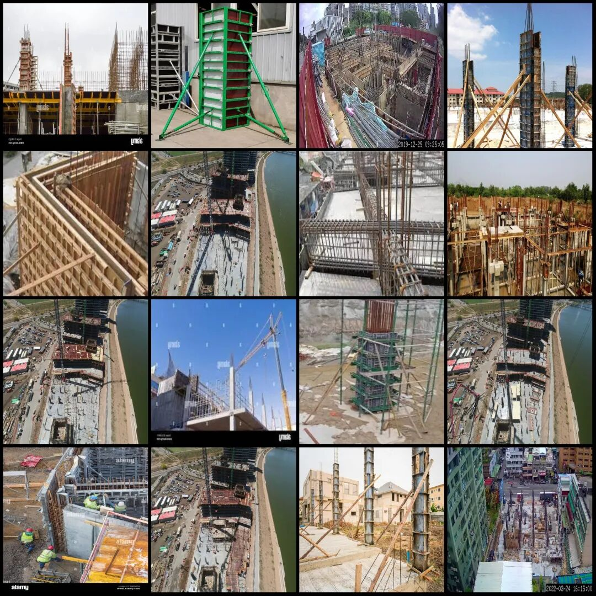
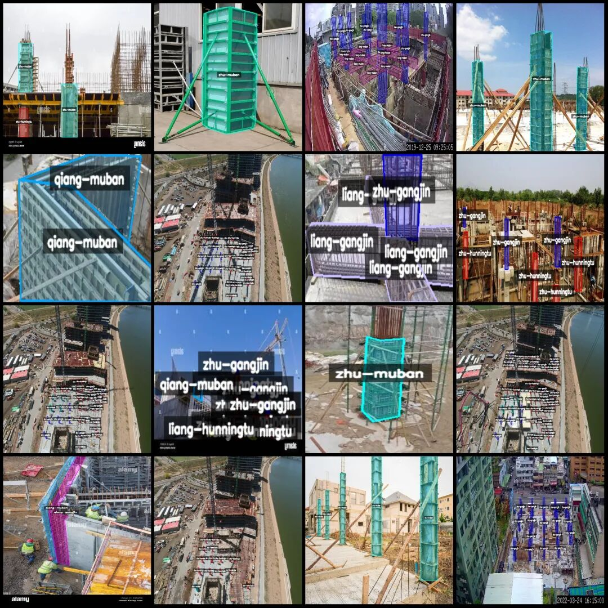
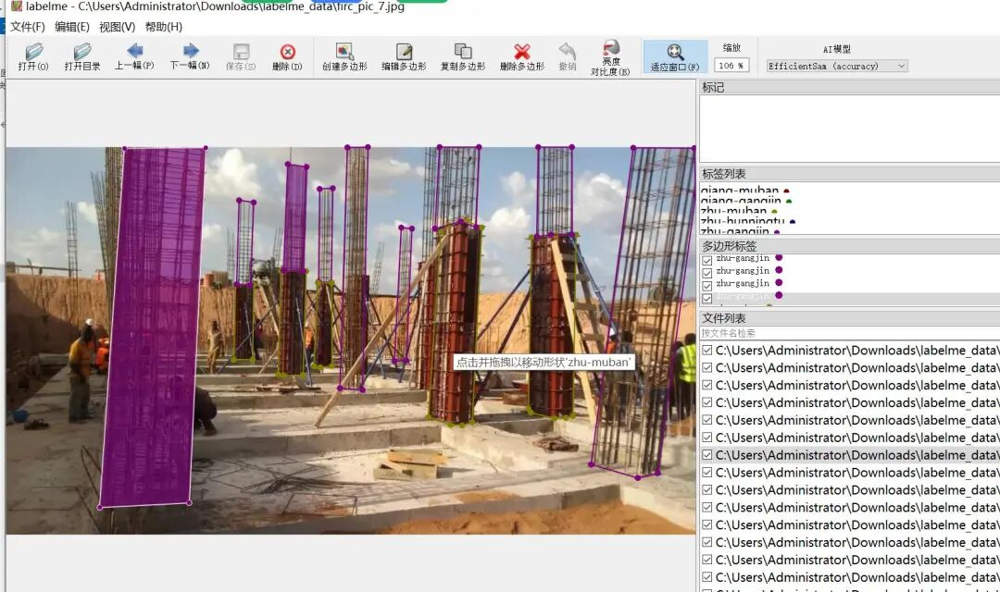

# Intelligent Construction Site: Recognition and Segmentation of Reinforced Concrete Formwork for Building Beams, Walls, and Pillars - LabelMe format with 387 images across 9 categories

Dataset format: labelme format (without mask files, only including jpg images and corresponding json files)

Number of images (number of jpg files): 387

Number of annotations (number of json files): 387

Label category count: 9

Annotation category names: ["liang-gangjin", "liang-hunningtu", "liang-muban", "qiang-gangjin", "qiang-hunningtu", "qiang-muban", "zhu-gangjin", "zhu-hunningtu", "zhu-muban"]

["Beam-Reinforcement", "Beam-Concrete", "Beam-Formwork", "Wall-Reinforcement", "Wall-Concrete", "Wall-Formwork", "Column-Reinforcement", "Column-Concrete", "Column-Formwork"]

Number of boxes labeled in each category:

liang-gangjin count = 389

liang-hunningtu count = 337

liang-muban count = 444

qiang-gangjin count = 86

qiang-hunningtu count = 111

qiang-muban count = 127

zhu-gangjin count = 2698

zhu-hunningtu count = 2667

zhu-muban count = 652

Total frame count: 7511

Using labeling tool: labelme=5.5.0

Image resolution: Multi-resolution images, such as 1920x1280, 930x837, etc.

Annotation rules: Draw polygons around the categories.

Important Notice: The dataset can be opened and edited using LabelMe. For JSON datasets, one must convert them into mask or Yolo formats for semantic segmentation or instance segmentation.

Special : This dataset does not guarantee the accuracy of the trained models or weight files.

Image Preview:

Annotation example:

Original image (pick 16 randomly):

Annotation:

LabelMe editing example:

## Payment

Here is a pay link on Stripe ( https://buy.stripe.com/3cs8yP7sY87d0vu9AB ). Please contact me lonlonago@foxmail.com after funding $89, and I will send you a complete data files , thank you!

